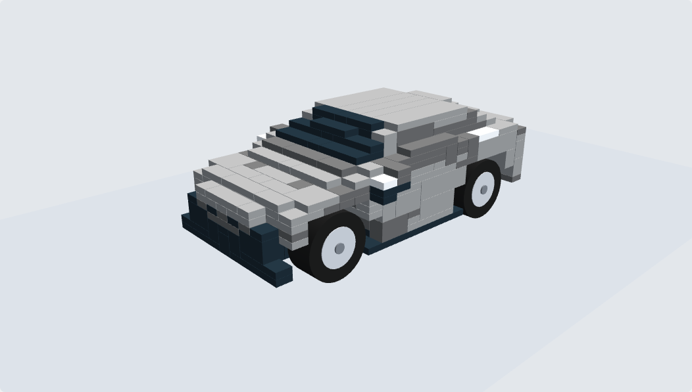
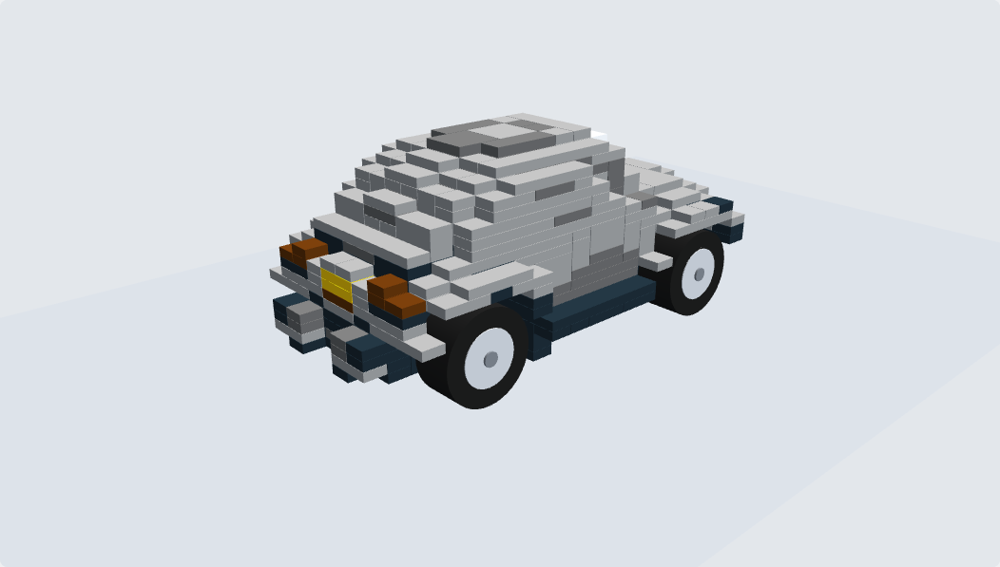
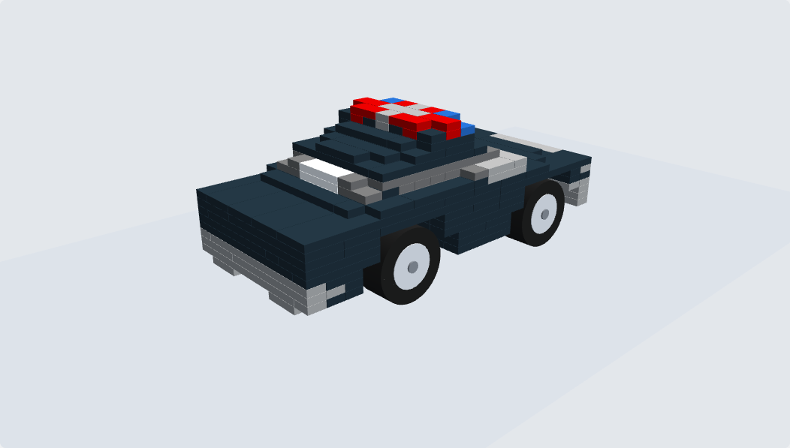
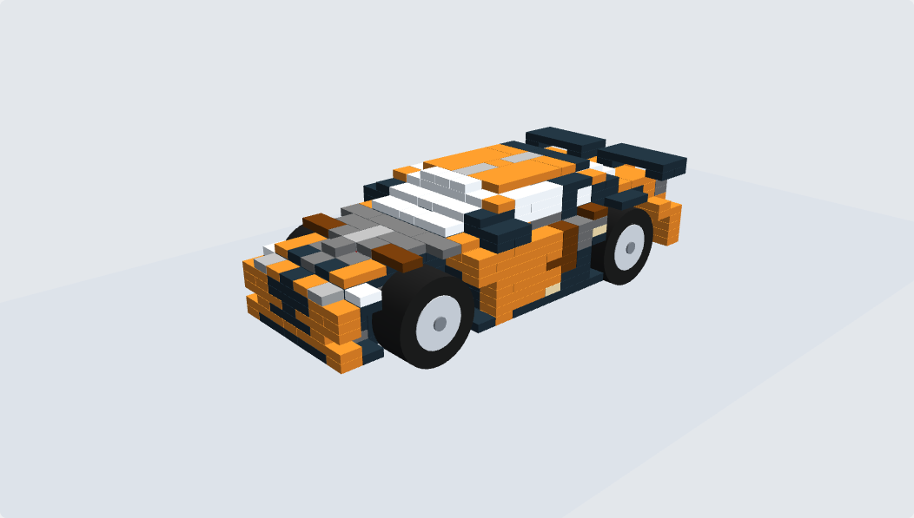
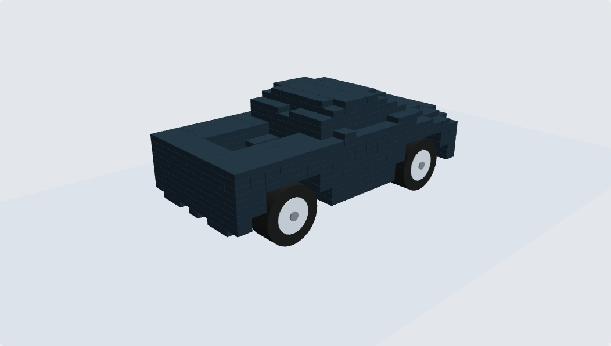
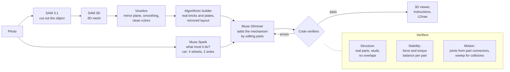

# SAMgo

Photo of an object -> a LEGO model of *that* object that actually works: a car that rolls, a door that swings.
Built for the Meta Global AI Developer Hackathon (submission Wed Nov 4, 2026).

| Camry (from a photo) | Beetle (from a photo) |
|---|---|
|  |  |

| Training cars (Objaverse models through the same builder) | | |
|---|---|---|
|  |  |  |

Every brick is a real LEGO part (LDraw IDs); wheels sit in the body's own tire outlines on real-length Technic
axles; shape, colors and brickwork are mirror-symmetric.

## How it works



- **Body (code):** the SAM 3D mesh becomes a faithful, buildable LEGO body: mirror-symmetric, smoothed, built as a
  frame and a hollow shell like real cars (`samgo/voxelize.py`, `samgo/builder.py`, cars: `samgo/arches.py`).
  Windows become glass (`samgo/glass.py`); every part gets a color LEGO actually produced (`samgo/colors.py`).
- **Mechanisms (Glimmer):** Glimmer edits the body to make it work: Technic running gear (one axle per step), and
  hinges, turntables, axles, wheels and crank arms on chairs, bicycles, car doors, TVs and laptops. It sees the
  parts near the mechanism and what the object must do; it never sees the reference answer.
- **Verifiers (code):** structure, static force balance, and a generic motion check that finds joints from how
  part connectors meet and sweeps moving parts for collisions (`samgo/verifier.py`, `samgo/stability.py`,
  `samgo/kinematics.py`). Errors go back to Glimmer, which corrects its answer (up to 3 rounds).
- **Outputs:** 3D viewer with a sampled motion preview (`samgo/viewer3d.py`), LDraw files checked part by part
  against the official LDraw library (`samgo/ldraw.py`), and building instructions whose steps carry an exact,
  independently checked certificate (`samgo/manual.py`).

## Results (Nov 1)

What Glimmer learned, measured on frozen test sets made before training (Muse Glimmer 30B, LoRA SFT on Fireworks):

| Test | Run 3 (cars only) | Run 4 (all mechanisms) |
|---|---|---|
| Held-out instances of the 7 trained object families (place or repair the mechanism) | 1/72 | **67/72** |
| Never-trained families (skateboard, microwave): repair a broken mechanism | 4/20 | **20/20** |
| Never-trained families: place the whole mechanism | 0/20 | 0/20 |
| Held-out cars: add Technic running gear | 48/50 | 46/50 |

- Glimmer learns the mechanisms it is shown and transfers *repairs* to unseen objects, but not *placing* a whole
  mechanism in an object family it never saw. That is the current limit.
- Live from photos (cached SAM 3D meshes): the Beetle gets Glimmer's running gear, glass and produced colors and
  passes structure, function and stability. The Camry's rear axle still fails (Technic bricks one size too short).
- Door placement on the photo cars by Glimmer fails: run 4's door examples were two fixed cars, so it memorised
  their running gear. Run 5 trains on doors cut into ~700 varied cars, plus the too-short-brick corrections.
- Physical evidence: every model exports to LDraw with no part off by more than 0.4 mm from the official library
  geometry; the skateboard's instructions are formally certified (9 steps). Nothing has been built physically yet.

| Built by | What |
|---|---|
| Glimmer (trained) | Technic running gear on cars; placing/repairing hinges, turntables, axles, wheels, crank arms in trained families |
| Code (verified) | bodies from photos, glass, colors, door openings; chair, bicycle, skateboard, microwave builders |
| Checks | structure, stability, motion (sampled sweeps); exact certificates for the instruction steps under a stated model |

## Run it

Use the external venv (the repo's `.venv` can hang on iCloud):

```bash
export UV_PROJECT_ENVIRONMENT=$HOME/.venvs/samgo
uv sync --locked --inexact

# Photo -> verified build + instructions (needs SAM/Spark keys in .env)
PYTHONPATH=. uv run --no-sync python -m samgo.pipeline photos/camry.jpg --prompt car --car -o runs/photo-camry
# ... with Glimmer placing the running gear and door hinges (Fireworks sampler checkpoint; see docs/photo-pipeline.md)
PYTHONPATH=. uv run --no-sync python -m samgo.pipeline photos/beetle.jpg --prompt car --car --assembly learned \
    --model <sampler path> --doors -o runs/photo-beetle

# Certified instructions and LDraw for any model
PYTHONPATH=. uv run --no-sync python -m samgo.manual runs/demo/skateboard/skateboard.json
PYTHONPATH=. uv run --no-sync python -m samgo.ldraw runs/demo/skateboard/skateboard.json

# Training bases: Objaverse vehicles -> verified LEGO cars at 16/20/24 studs
PYTHONPATH=. uv run --no-sync python -m samgo.gen_bases --workers 8

# Running-gear SFT rows from the bases (train/val split by vehicle)
PYTHONPATH=. uv run --no-sync python -m samgo.gen_running_gear --bases runs/bases --out data/running_gear

# Interactive 3D viewer for any builds
PYTHONPATH=. uv run --no-sync python -m samgo.viewer3d out.html "Camry=runs/s6/camry/arched_build.json"

# Tests
PYTHONPATH=. uv run --no-sync python -m pytest -q tests/
```

## Layout

- `samgo/`: perception, voxelizer, builders, verifiers, mechanism tasks, data generators, viewer.
- `brickgpt/`: the BrickGPT replication on Glimmer (data, decoder, Fireworks training and evaluation).
- `spec.md`: the plan (section 0 is current). `docs/archive/`: earlier plans. `reports/`: research.
