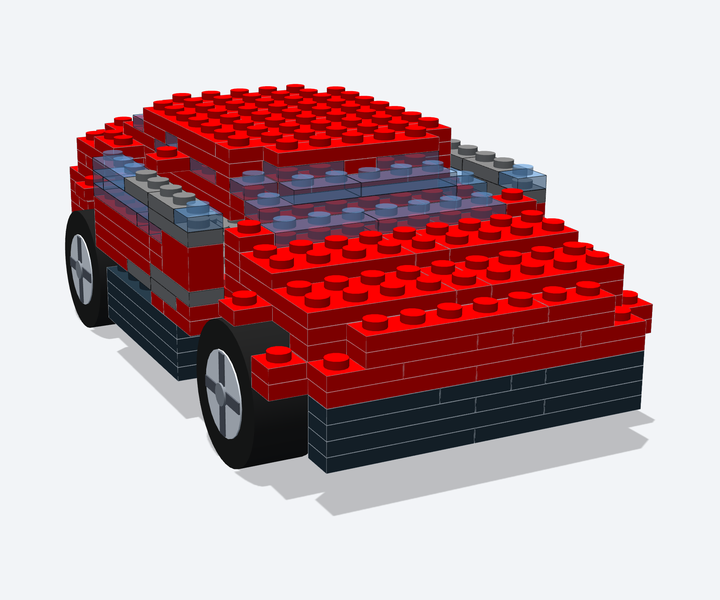
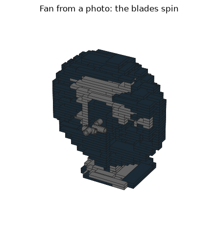
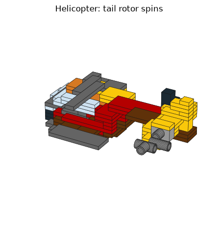
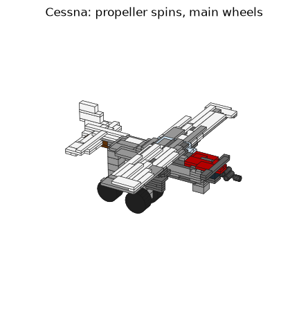
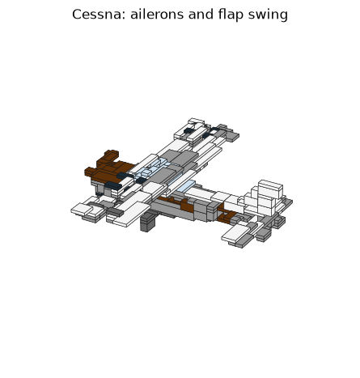
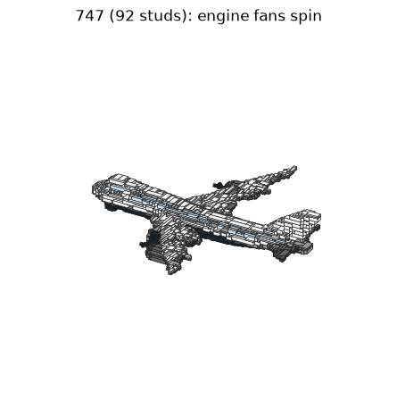
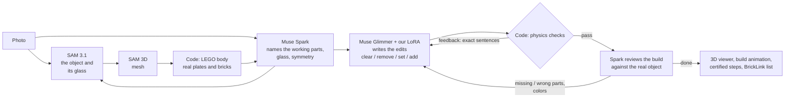

# SAMgo

**A photo of any machine -> a LEGO model of it that works, and that you can actually build.**

A car whose wheels roll and doors swing, a fan whose blades spin, a Cessna with a turning propeller and swinging
ailerons, a helicopter with its tail rotor, an airliner with its engine fans: the same models and the same code, with
nothing written for any one object. Built for the Meta Global AI Developer Hackathon (Indie track, "Push the
Frontier"), Oct 27 - Nov 4, 2026, on Meta's models: **SAM 3.1**, **SAM 3D**, **Muse Spark** and **Muse Glimmer**
(fine-tuned by us).

| Camry (from a photo) | Fan (held-out) | Helicopter (held-out) |
|---|---|---|
|  |  |  |
| **Cessna: propeller, main wheels** | **Cessna: ailerons and flap** | **747 at 92 studs: engine fans** |
|  |  |  |

Every object except the cars was a **held-out exam**: never in training, never tuned for.

## How it works: Spark knows, Glimmer does, code verifies



- **Spark knows** (Muse Spark Open). From the photo and its world knowledge it names the object's working parts -
  hinged panels, spinning parts (propellers, fans, rotors), legs and wheels - and points where each goes; says
  which are mirror twins and whether the object is mirror-symmetric; names its transparent parts; and, after the
  build, **reviews it against the real object**: missing working parts are added, wrong ones dropped (only once a
  replacement passes), and colors corrected (a base color, then the trim). It never places a brick.
- **SAM sees.** SAM 3.1 cuts the object out of the photo and also finds exactly the pixels of the glass Spark named
  ("windshield", "side windows"); those are marked before SAM 3D builds the mesh, so the LEGO model's glass is where
  the photo shows it, mirrored to the hidden side.
- **Glimmer does** (Muse Glimmer 30B + our LoRA, trained on Fireworks). It gets the parts near the spot and one
  generic sentence ("set a rotor into this face", "one edge of a flat structure should swing") and writes the edit
  list. It is the only thing that builds. Each round it gives several answers at once and the checker keeps one that
  passes.
- **Code verifies.** Every part is a real LEGO element; nothing overlaps; every part is held by studs (joint halves
  included); no axle passes through plastic except at a round hole; the mechanism turns or swings clear; the model
  stands (exact force balance per part); the build order is certified step by step. Failures become **feedback**:
  exact sentences ("input part 86 overlaps your bar plate: remove it first", "this clip holds nothing") that Glimmer
  uses to fix its answer, up to 3 rounds. Anything Glimmer fails to build is left out and reported, never built by
  code instead.

**Nothing is object-specific.** Glimmer's training data is generic bodies (blocks, panels, lids, fins, shelves) with
generic skills; the airliner, Cessna, helicopter and fan are held-out exams.

## What Glimmer learned (10 training runs)

Frozen test sets, made before training and never regenerated (`runs/audit/`). First try / within 3 feedback rounds.

| Test (unseen bodies) | Run 7 | Run 8 | Run 9 | **Run 10** |
|---|---|---|---|---|
| **Rotor** set into a face, spins 360° clear (30) | - | 1 | - | **30 / 30** |
| Hinge a flat sheet's edge (30) | - | 14 / 15 | 15 / 22 | 15 / 19 |
| Hinge a strip on a block (20) | 15 | 14 / 15 | 13 / 13 | 14 / 15 |
| Add a leg with a wheel (20) | 19 | 19 | 20 | 20 |
| Car running gear, held-out cars (50) | 48 / 50 | 48 / 49 | 48 / 50 | 45 / 47 |
| Door hinges on unseen vehicles (10) | 9 | 10 | 9 | 10 |
| Objects: place/repair a mechanism (112) | 87 | 92 | 88 | 87 |

On real photos, run 10 built the fan's rotor on the first try in 5 of 5 runs on two fan photos, the Cessna's
propeller, ailerons and flap, the helicopter's tail rotor, and the 747's engine fans (one built, its twin mirrored).

What moved the numbers (details in `fireworks-training-runs/*/run.md`): a `clear` edit (Glimmer is bad at cell
bookkeeping, good at decisions: hinges 4/20 -> 15/20); mistake -> feedback -> fix rows from Glimmer's own wrong
answers; physical checks that found bugs in our own data (a clip hanging over empty space used to pass); a generic
rotor skill (1/30 -> 30/30); several answers per round with the checker choosing.

## Proofs and checks

- `formal/MergeRule.lean` (Lean 4): merging neighbouring pieces into one real piece keeps every cell and every
  outside stud grip (`samgo/consolidate.py`; `tests/test_consolidate.py` ties the code to the proof).
- `formal/AnimationPath.lean` (Lean 4): every piece of the build animation arrives along a path that never passes
  through a placed piece, and an axle slid along a hole's line never meets the brick's plastic (`samgo/animation.py`
  checks exactly these hypotheses for every move).
- `samgo/manual.py`: build order certified step by step with an exact rational force balance.
- The wheel catalogue (`scripts/wheel_catalog.py`) pairs rims and tyres from the official LDraw geometry; every model
  exports to LDraw with no part off by more than 0.4 mm. 351 tests (`pytest`).

## Build one for real

Every passing model gets a build kit (`python -m samgo.build_kit <artifacts> <out>`): `parts.csv` and a
**BrickLink wanted list** with the exact parts, `model.ldr` for BrickLink Studio, and the certified build order as
one picture per step. The red Camry: 286 elements, 49 certified steps (`runs/build_kit/camry_red_certified`).
`demo.md` has the shopping list and the demo video plan.

## Run it

```bash
export UV_PROJECT_ENVIRONMENT=$HOME/.venvs/samgo     # the repo .venv can hang on iCloud
uv sync --locked --inexact
# keys in .env (see .env.example): MODEL_API_KEY (Meta Model API, SAM 3.1), FAL_KEY (SAM 3D),
# BASETEN_API_KEY (Muse Spark), FIREWORKS_API_KEY (Glimmer)

# Any object: Spark names its working parts, Glimmer builds them, code checks, Spark reviews
PYTHONPATH=. python -m samgo.pipeline photos/fan.jpg --prompt fan --static --assembly learned \
    --model <Glimmer sampler> -o runs/fan                        # --size large | 100 (studs) for bigger models
# Cars: running gear, doors, glass, paint
PYTHONPATH=. python -m samgo.pipeline photos/car.jpg --prompt car --car --assembly learned \
    --model <Glimmer sampler> --doors --buildable --color red -o runs/car

python -m samgo.viewer3d out.html "Car=runs/car/artifacts/<run>/build.json"   # 3D: Build it, Preview motion
python -m samgo.build_kit runs/car/artifacts/<run> runs/car_kit --title "My car"  # parts list + steps
PYTHONPATH=. python -m pytest -q tests/
lean formal/MergeRule.lean && lean formal/AnimationPath.lean
```

Training: `brickgpt/train_serverless.py` (LoRA rank 32, batch 64, 2 epochs, Fireworks serverless); each run's chain
script and results are in `runs/rN_chain.sh` and `fireworks-training-runs/objects-rN/run.md`. Latest sampler (run 10):
`vvennela/run-261ba12dc52b48fba4252347dae2bd99/objects-r10-s24576-591aac60`.

## Layout

- `samgo/pipeline.py`: photo -> model. `samgo/perceive.py`: SAM 3.1 + SAM 3D (object and glass).
- Spark: `samgo/spark_mechanisms.py` (working parts, mirror twins, parallel build), `samgo/spark_review.py` (review
  against the real object), `samgo/spark_glass.py`, `samgo/spark_gear.py`, `samgo/spark_symmetry.py`,
  `samgo/car_layout.py`, `samgo/part_layout.py`.
- Checks: `samgo/free_edit_test.py` (`check`, `explain` = feedback), `samgo/kinematics.py` (joints, motion),
  `samgo/stability.py`, `samgo/manual.py`, `samgo/verifier.py`, `samgo/technic.py`.
- Outputs: `samgo/viewer3d.py` (3D, motion, build animation), `samgo/animation.py`, `samgo/build_kit.py`,
  `samgo/ldraw.py`.
- Skill data: `samgo/rotor_data.py`, `samgo/flap_data.py`, `samgo/primitives.py`, `samgo/flap_mistakes.py`.
- `formal/`: Lean proofs. `docs/`: handoff, feedback example, photo sources. `demo.md`: the demo plan.

## Limits

- Glimmer does not yet place every working part on large, thin, stepped models (most 747 flaps and ailerons fail),
  and rotor arms are the trained 2-stud size. Vertical rotors (a helicopter's main rotor) and wheels sized to the
  object (verified 24-36 mm wheels are in the catalogue) need one more training run.
- One photo gives limited depth: a flat painting of a wind turbine came out too thin for a rotor bearing.
- Photos: `docs/photo-sources.txt` (public domain / CC; photos are not in the repo).
