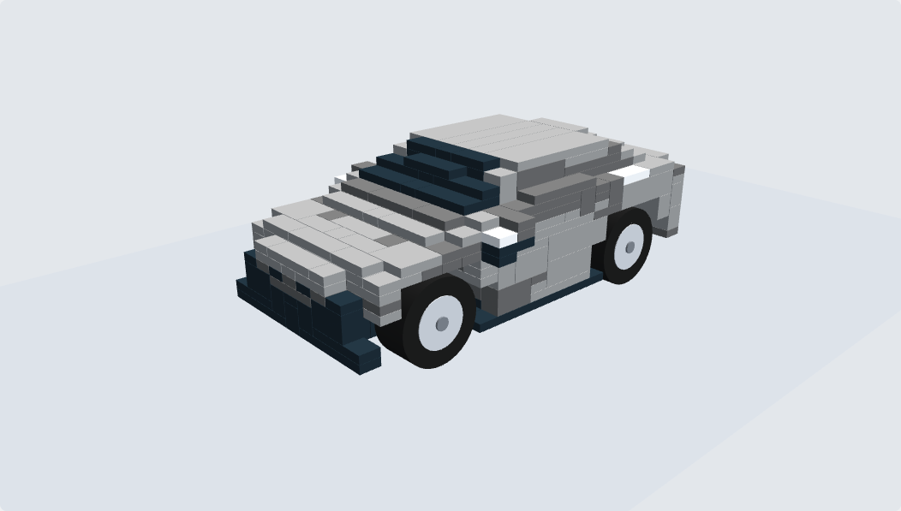
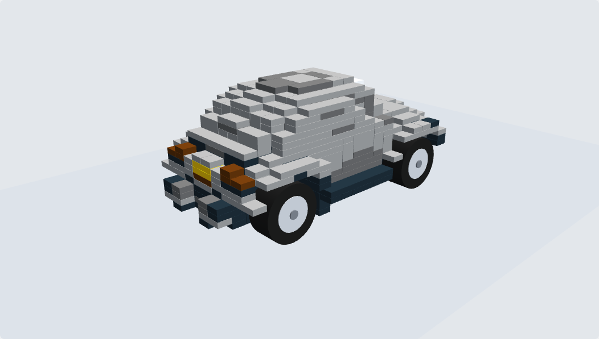
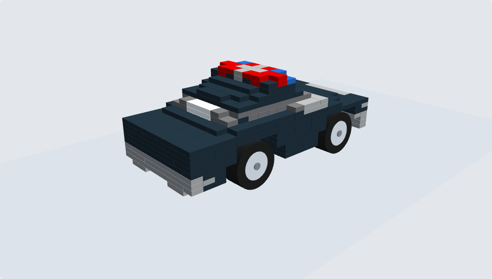
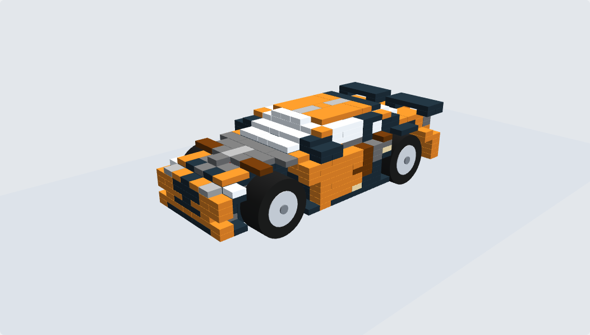
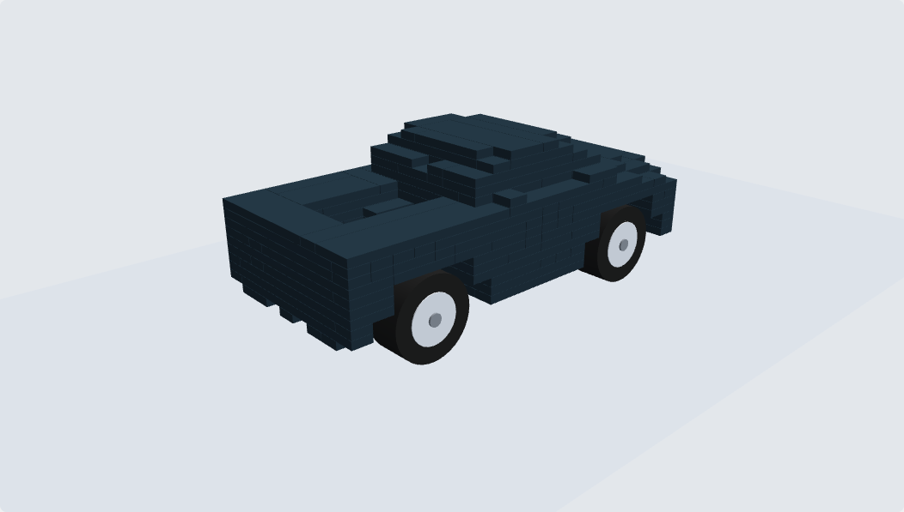
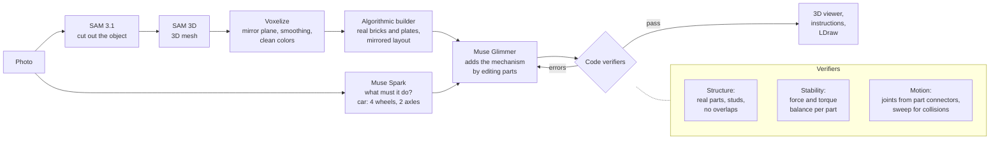

# SAMgo

Photo of an object -> a LEGO model of *that* object that actually works: a car that rolls, a door that swings.
Built for the Meta Global AI Developer Hackathon (submission Wed Nov 4, 2026).

| Camry (from a photo) | Beetle (from a photo) |
|---|---|
|  |  |

| Training cars (Objaverse models through the same builder) | | |
|---|---|---|
|  |  |  |

Every brick is a real LEGO part (LDraw IDs); wheels sit in the body's own tire outlines on real-length Technic
axles; shape, colors and brickwork are mirror-symmetric.

## How it works



- **Body:** the algorithm turns the SAM 3D mesh into a faithful, buildable LEGO body (`samgo/voxelize.py`,
  `samgo/builder.py`, cars: `samgo/arches.py`).
- **Mechanism:** Glimmer edits the body to make it work (running gear today; hinges, lids and turntables next).
  It sees the parts near the mechanism and the region code found (e.g. where each tire is).
- **Verifiers:** structure (`samgo/verifier.py`), static force balance (`samgo/stability.py`), and a generic
  motion check that finds joints from how part connectors meet and sweeps moving parts for collisions
  (`samgo/kinematics.py`). Errors go back to Glimmer for up to 3 retries.
- **Training:** examples come from verified builds with their mechanism removed; the answer is the edits that
  restore it. SFT on Glimmer (Fireworks LoRA), GRPO optional. Plan: `spec.md` section 0.

## Status (Oct 30)

| Piece | State |
|---|---|
| Photo -> body (SAM 3.1, SAM 3D, voxelize, builder) | works; symmetric, smoothed, clean colors |
| Cars: wheels in tire outlines, real axles, stands | works (`samgo/arches.py`); ~900 Objaverse training cars built |
| Running-gear training examples | generator works (`samgo/gen_running_gear.py`) |
| Untrained Glimmer on running gear | 2 of 4 photo cars with verifier feedback |
| Generic motion checker | works on test builds: car, locked car, hinged door, preset door, laptop lid, TV turntable |
| Fine-tuning run 1 (running gear) | not launched yet |
| TV turntable, laptop lid, microwave door, bicycle | in progress (`samgo/mechanism_bases.py`) |
| BrickGPT replication on Glimmer (v1) | done: valid builds 50% -> 88%, stable 19% -> 63% on held-out prompts |

The photo pipeline (`samgo/pipeline.py`) still builds cars with the older lifted-chassis builder (`samgo/car.py`);
the arched builder is used for training data and will replace it.

## Run it

Use the external venv (the repo's `.venv` can hang on iCloud):

```bash
export UV_PROJECT_ENVIRONMENT=$HOME/.venvs/samgo

# Photo -> verified build + instructions (needs SAM/Spark keys in .env)
PYTHONPATH=. uv run --no-sync python -m samgo.pipeline photos/camry.jpg --prompt car -o runs/s6/camry

# Training bases: Objaverse vehicles -> verified LEGO cars at 16/20/24 studs
PYTHONPATH=. uv run --no-sync python -m samgo.gen_bases --workers 8

# Running-gear SFT rows from the bases (train/val split by vehicle)
PYTHONPATH=. uv run --no-sync python -m samgo.gen_running_gear --bases runs/bases --out data/running_gear

# Interactive 3D viewer for any builds
PYTHONPATH=. uv run --no-sync python -m samgo.viewer3d out.html "Camry=runs/s6/camry/arched_build.json"

# Tests
PYTHONPATH=. uv run --no-sync --with matplotlib python -m pytest -q tests/
```

## Layout

- `samgo/`: perception, voxelizer, builders, verifiers, mechanism tasks, data generators, viewer.
- `brickgpt/`: the BrickGPT replication on Glimmer (data, decoder, Fireworks training and evaluation).
- `spec.md`: the plan (section 0 is current). `docs/archive/`: earlier plans. `reports/`: research.
