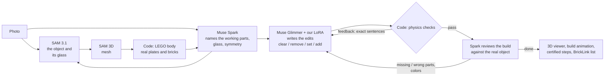

# SAMgo

**One photo of a machine → a LEGO model of it that works, and that you can actually build.**

Wheels that roll, doors that swing, propellers, rotors and engine fans that spin: SAMgo turns a single photo into a
LEGO model made only of real parts, with working mechanisms, a certified step-by-step manual and a parts list you can
order. Built in one week for the Meta Global AI Developer Hackathon (Oct 27 - Nov 4, 2026) on **SAM 3.1**, **SAM 3D**,
**Muse Spark** and **Muse Glimmer**, fine-tuned by us.

- **Demo video (3 min):** https://youtu.be/jUHE-NSDsxY
- **Model (Muse Glimmer 30B + our LoRA, run 11):** https://huggingface.co/vvennelakanti/samgo-glimmer-lora-r11
- **Training data, script and card:** https://huggingface.co/datasets/vvennelakanti/samgo-glimmer-train-r11

| Camry (from a photo) | Fan (held-out) | Helicopter (held-out) |
|---|---|---|
|  |  |  |
| **Cessna: propeller, main wheels** | **Cessna: ailerons and flap** | **747 at 92 studs: engine fans** |
|  |  |  |

Every object except the cars was a **held-out exam**: never in training, never tuned for. The showcase models
(Camry, supercar, 747, helicopter, Cessna) are the pipeline's builds completed with SAMgo's own mechanism builders
(`runs/hand_finished/`), every one verified by the same checker.

## What SAMgo achieves

- **Real LEGO, not a picture.** Every part is a real catalogue element (official LDraw geometry, within 0.4 mm). The red
  Camry is 320 parts with a 56-step manual, a BrickLink wanted list and a model for BrickLink Studio
  (`runs/build_kit/camry_red_current/`).
- **Verified, piece by piece.** Nothing overlaps, every part is held by studs (joint halves included), axles pass only
  through holes, mechanisms swing or spin clear, the model stands under an exact force balance, and every step of the
  build is certified to hold.
- **Any size.** The same photo at full scale is 140,493 pieces, every piece connected; scaled down to 293 pieces it keeps
  its shape.
- **Working mechanisms, built by a model.** Muse Glimmer, fine-tuned by us, writes every mechanism: axles and wheels,
  hinges, side rotors, rotors on turntables. It reads the checker's exact feedback and fixes its own answer.
- **It generalizes.** Trained only on generic blocks and panels with generic skills, it built the engine fans of a 747,
  a helicopter's rotors and a Cessna's propeller and ailerons, none of which it had seen.

## How it works: Spark knows, Glimmer builds, code verifies



| Meta model | Where | What it does |
|---|---|---|
| **SAM 3.1** (Meta Model API) | `samgo/perceive.py` | cuts the object out of the photo; finds the pixels of each glass part Spark names |
| **SAM 3D** | `samgo/perceive.py` | turns the one photo (object mask, glass marked) into a textured 3D mesh |
| **Muse Spark** | `samgo/spark_*.py`, `samgo/car_layout.py`, `samgo/part_layout.py` | names the working parts and where they go (wheels, doors, rotors, flaps), mirror twins, glass, colours; reviews the build against the photo |
| **Muse Glimmer 30B** + our LoRA | `samgo/assembly.py`, `samgo/spark_mechanisms.py`, `samgo/learned_mechanisms.py` | the only thing that builds: writes the edit list that adds axles, wheels, hinges, rotors and turntables, and fixes it from the checker's feedback |

The checker's findings become exact sentences ("input part 86 overlaps your bar plate: remove it first", "this clip
holds nothing") that Glimmer uses to fix its answer, up to 3 rounds. Nothing is object-specific: no object names in
the training data, prompts or code.

## What Glimmer learned

Frozen test sets, made before training and never regenerated (`runs/audit/`). First try / within 3 feedback rounds.

| Test (unseen bodies) | Run 8 | Run 9 | Run 10 | **Run 11** |
|---|---|---|---|---|
| **Rotor** set into a face, spins 360° clear (30) | 1 | - | 30 / 30 | 28 |
| **Upright rotor**: blades on a turntable, turn 360° clear (30) | - | - | 8 | **19 / 24** |
| Hinge a flat sheet's edge (30) | 14 / 15 | 15 / 22 | 15 / 19 | 14 / 20 |
| Hinge a strip on a block (20) | 14 / 15 | 13 / 13 | 14 / 15 | 14 / 15 |
| Add a leg with a wheel (20) | 19 | 20 | 20 | 20 |
| Car running gear, held-out cars (50) | 48 / 49 | 48 / 50 | 45 / 47 | **48 / 50** |
| Door hinges on unseen vehicles (10) | 10 | 9 | 10 | **10** |
| Objects: place/repair a mechanism (112) | 92 | 88 | 87 | **92** |

What moved the numbers (details in `fireworks-training-runs/*/run.md`): a `clear` edit (Glimmer makes the decisions,
code does the cell bookkeeping: hinges 4/20 -> 15/20); mistake -> feedback -> fix rows built from Glimmer's own
answers; physical checks strict enough to catch a clip hanging over empty space; generic rotor skills (side rotors
1/30 -> 30/30, upright rotors 8/30 -> 24/30); several answers per round with the checker choosing.

## Proofs and checks

- `samgo/manual.py`: the build order certified step by step with an exact rational force balance.
- `formal/MergeRule.lean` (Lean 4): merging neighbouring pieces into one real piece keeps every cell and every
  outside stud grip (`samgo/consolidate.py`; `tests/test_consolidate.py` ties the code to the proof).
- `formal/AnimationPath.lean` (Lean 4): every piece of the build animation arrives along a path that never passes
  through a placed piece, and an axle slid along a hole's line never meets the brick's plastic.
- 353 tests (`pytest`).

## Run it

```bash
export UV_PROJECT_ENVIRONMENT=$HOME/.venvs/samgo
uv sync --locked --inexact
# keys in .env (see .env.example): MODEL_API_KEY (Meta Model API, SAM 3.1), FAL_KEY (SAM 3D),
# BASETEN_API_KEY (Muse Spark), FIREWORKS_API_KEY (Glimmer)

# Any object: Spark names its working parts, Glimmer builds them, code checks, Spark reviews
PYTHONPATH=. python -m samgo.pipeline photos/fan.jpg --prompt fan --static --assembly learned \
    --model <Glimmer sampler> -o runs/fan                        # --size large | 100 (studs) for bigger models
# Cars: running gear, doors, glass, paint
PYTHONPATH=. python -m samgo.pipeline photos/car.jpg --prompt car --car --assembly learned \
    --model <Glimmer sampler> --doors --buildable --color red -o runs/car

python -m samgo.viewer3d out.html "Car=runs/car/artifacts/<run>/build.json"   # 3D: Build it, Preview motion
python -m samgo.build_kit runs/car/artifacts/<run> runs/car_kit --title "My car"  # parts list + steps
PYTHONPATH=. python -m pytest -q tests/
```

**SAMgo Studio** shows a run with every model call: `scripts/studio_run.py` takes the same arguments as
`samgo.pipeline` and logs each call to SAM 3.1, SAM 3D, Muse Spark and Muse Glimmer (what was asked, the answer, how
long it took); `python scripts/studio.py <out dir>` shows it live at http://127.0.0.1:8765.

Training: `brickgpt/train_serverless.py` (LoRA rank 32, batch 64, 2 epochs, Fireworks serverless). Each run's chain
script and notes are in `runs/rN_chain.sh` and `fireworks-training-runs/objects-rN/run.md`; run 11 is the model used
everywhere.

## Layout

- `samgo/pipeline.py`: photo -> model. `samgo/perceive.py`: SAM 3.1 + SAM 3D.
- Spark: `samgo/spark_mechanisms.py`, `samgo/spark_review.py`, `samgo/spark_glass.py`, `samgo/spark_gear.py`,
  `samgo/spark_symmetry.py`, `samgo/car_layout.py`, `samgo/part_layout.py`.
- Checks: `samgo/free_edit_test.py` (`check`, `explain` = feedback), `samgo/kinematics.py`, `samgo/stability.py`,
  `samgo/manual.py`, `samgo/verifier.py`, `samgo/technic.py`.
- Outputs: `samgo/viewer3d.py`, `samgo/animation.py`, `samgo/build_kit.py`, `samgo/ldraw.py`; `scripts/studio*.py`.
- Training: `brickgpt/`, skill data generators (`samgo/rotor_data.py`, `samgo/flap_data.py`, `samgo/primitives.py`,
  `samgo/flap_mistakes.py`), frozen tests in `runs/audit/`, one note per run in `fireworks-training-runs/`.
- `formal/`: Lean proofs. `docs/`: verification notes, a feedback example, images, photo sources (photos are not in the
  repo).
