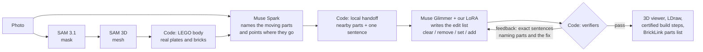

# SAMgo

**A photo of any machine -> a LEGO model of it that works and that you can actually build.** A car whose wheels roll
and doors swing, a fan whose blades spin, an airliner with moving flaps and landing gear: same models, same code,
nothing written for any one object.

Built for the Meta Global AI Developer Hackathon (Indie track, "Push the Frontier"), Oct 27 - Nov 4, 2026, on Meta's
models: **SAM 3.1**, **SAM 3D**, **Muse Spark** and **Muse Glimmer** (fine-tuned by us).

| Camry (from a photo) | Beetle (from a photo) |
|---|---|
|  |  |

<!-- SHOWCASE -->

## Spark knows, Glimmer does, code verifies



- **Spark knows** (Muse Spark Open): from the photo it names the object's parts and which of them move - hinged
  panels, spinning parts, legs/wheels, transparent parts - and points at where each goes on the LEGO model. World
  knowledge only; it never places a brick.
- **Glimmer does** (Muse Glimmer 30B + our LoRA, trained on Fireworks): it gets a small local handoff (the parts near
  the spot and one generic sentence such as "one edge of a flat structure should swing") and writes the edit list
  that builds the mechanism. It is the only thing that builds; it never decides what the object is.
- **Code verifies**: every part is a real LEGO element, nothing overlaps, every part is held by studs (joint halves
  included), the mechanism moves through its range without collisions, the model stands, and the build order is
  certified step by step with an exact force balance (`samgo/manual.py`). Failures become **feedback**: precise
  sentences ("input part 86 overlaps your bar plate: remove it first", "this clip holds nothing") that Glimmer uses to
  fix its answer, up to 3 rounds. Anything Glimmer fails to build is left out and reported; code never builds it
  instead.

**Nothing is object-specific.** There is no airplane, fan or car template. Glimmer's training data is generic bodies
(panels, lids, fins, shelves, blocks) with generic skills: hinge an edge, add a leg with a wheel, set a rotor into a
face, cut and hang a door, put Technic running gear in. The airliner, fan and wind turbine below are **held-out
exams**, never trained or tuned on.

## Skills Glimmer learned (10 training runs)

Frozen test sets, made before training and never regenerated (`runs/audit/`). First try / within 3 feedback rounds.

| Test (unseen bodies) | Run 7 | Run 8 | Run 9 | **Run 10** |
|---|---|---|---|---|
| **Rotor** set into a face, spins 360° clear (30) | - | 1 | - | **30 / 30** |
| Hinge a flat sheet's edge (30) | - | 14 / 15 | 15 / 22 | 15 / 19 |
| Hinge a strip on a block (20) | 15 | 14 / 15 | 13 / 13 | 14 / 15 |
| Add a leg with a wheel (20) | 19 | 19 | 20 | 20 |
| Car running gear, held-out cars (50) | 48 / 50 | 48 / 49 | 48 / 50 | 45 / 47 |
| Door hinges on unseen vehicles (10) | 9 | 10 | 9 | 10 |
| Objects: place/repair a mechanism (112) | 87 | 92 | 88 | 87 |

What moved the numbers (details in `fireworks-training-runs/*/run.md`):
1. **A `clear` edit** (empty a box, re-lay the cut parts as real plates): Glimmer is bad at cell bookkeeping and good
   at decisions. Hinges on unseen bodies 4/20 -> 15/20.
2. **Mistake -> feedback -> fix rows** from Glimmer's *own* wrong answers, so it learns to act on feedback instead of
   repeating itself (flap sheets within rounds 15 -> 22).
3. **Physical checks found real bugs in our own data**: a clip hanging on its bar over empty space used to pass; now a
   joint half whose studs grip nothing fails (`kinematics.dangling`) and the affected data was regenerated.
4. **A generic rotor skill** (bearing set into any face, axle out, arms locked to it): 1/30 -> 30/30.

## Build one for real

Every passing model comes with a build kit (`python -m samgo.build_kit <artifacts> <out>`):
`parts.csv` and a **BrickLink wanted list** to buy the exact parts, `model.ldr` for BrickLink Studio, and the
**certified build order** as one picture per step. LDraw export is checked part by part against the official LDraw
library (no part off by more than 0.4 mm). The Camry kit: 282 parts, 49 certified steps (`runs/build_kit/camry`).

## Run it

```bash
export UV_PROJECT_ENVIRONMENT=$HOME/.venvs/samgo     # the repo .venv can hang on iCloud
uv sync --locked --inexact
# keys in .env (see .env.example): MODEL_API_KEY (Meta Model API, SAM 3.1), FAL_KEY (SAM 3D),
# BASETEN_API_KEY (Muse Spark), FIREWORKS_API_KEY (Glimmer)

# Any object: Spark names its mechanisms, Glimmer builds them, code checks
PYTHONPATH=. python -m samgo.pipeline photos/desk_fan.jpg --prompt fan --static --assembly learned \
    --model <Glimmer sampler> -o runs/fan
# Cars: running gear, doors, glass, certified manual
PYTHONPATH=. python -m samgo.pipeline photos/camry.jpg --prompt car --car --assembly learned \
    --model <Glimmer sampler> --doors --buildable --manual -o runs/camry

python -m samgo.viewer3d out.html "Fan=runs/fan/artifacts/<run>/build.json"     # interactive 3D, motion preview
python -m samgo.build_kit runs/camry/artifacts/<run> runs/camry_kit --title Camry  # parts list + steps
PYTHONPATH=. python -m pytest -q tests/
```

Training: `brickgpt/train_serverless.py` (LoRA rank 32, batch 64, 2 epochs, Fireworks serverless); each run's data,
chain script and results are in `runs/rN_chain.sh` and `fireworks-training-runs/objects-rN/run.md`.

## Layout

- `samgo/pipeline.py` photo -> model; `samgo/spark_mechanisms.py`, `samgo/part_layout.py`, `samgo/spark_gear.py`,
  `samgo/spark_glass.py`: Spark names and grounds mechanisms; `samgo/free_edit_test.py` (`check`, `explain` =
  feedback), `samgo/kinematics.py` (joints, motion), `samgo/stability.py`, `samgo/manual.py` (certified steps).
- Skill data generators: `samgo/flap_data.py`, `samgo/rotor_data.py`, `samgo/primitives.py`, `samgo/flap_mistakes.py`.
- `brickgpt/`: Fireworks training and the BrickGPT-style decoder on Glimmer. `docs/HANDOFF.md`: detailed state.
- Photo sources and licences: `docs/photo-sources.txt` (photos are not in the repo; download them from there).

## Limits (honest)

- Glimmer does not yet act on every feedback on big, dense real models (the 92-stud airliner: it sometimes moves a
  part over instead of removing what is in the way). The fix is more generic data on irregular bodies, not a patch.
- Very large models are not always certifiable step by step (an airliner fuselage overhangs the table).
- Colours come from the SAM 3D mesh texture, which can wash out dark liveries.
