# Build Camry (red) in LEGO

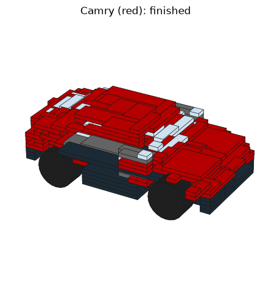

320 model parts (324 LEGO elements: wheels are a tyre and a rim), 56 steps.

Certified order (samgo.manual): every step is placed and held by stud forces within clutch, checked exactly. Orientation: from layer z=5 up, then turned over.

## Get the parts

- `parts.csv`: part numbers, colours, counts.
- `bricklink_wanted.xml`: on bricklink.com, Want -> Upload, paste it, then buy from the listed stores.
- `model.ldr`: open in BrickLink Studio to inspect in 3D (Studio can also price the parts).

| count | part | colour |
|---|---|---|
| 30 | 3024 | Red |
| 27 | 3623 | Red |
| 22 | 78329 | Red |
| 21 | 3710 | Red |
| 20 | 3023 | Red |
| 15 | 3022 | Red |
| 14 | 3701 | Black |
| 12 | 3023 | Trans-Clear |
| 12 | 3024 | Trans-Clear |
| 11 | 3021 | Red |
| 11 | 3623 | Black |
| 10 | 3710 | Black |
| 9 | 3666 | Red |
| 8 | 3623 | Trans-Clear |
| 7 | 3020 | Red |
| 7 | 3020 | Dark Bluish Gray |
| 6 | 3023 | Black |
| 6 | 3024 | Black |
| 5 | 3021 | Black |
| 5 | 3710 | Trans-Clear |
| 5 | 78329 | Black |
| 4 | 2429 | Dark Bluish Gray |
| 4 | 2430 | Dark Bluish Gray |
| 4 | 2994 | Light Bluish Gray |
| 4 | 3623 | Dark Bluish Gray |
| 4 | 3666 | Black |
| 4 | 3795 | Black |
| 4 | 6578 | Black |
| 3 | 3460 | Black |
| 3 | 3795 | Red |
| 3 | 4282 | Black |
| 2 | 23948 | Light Bluish Gray |
| 2 | 3031 | Red |
| 2 | 3032 | Black |
| 2 | 3460 | Red |
| 2 | 3460 | Dark Bluish Gray |
| 2 | 4282 | Dark Bluish Gray |
| 2 | 91988 | Dark Bluish Gray |
| 1 | 3004 | Red |
| 1 | 3031 | Dark Bluish Gray |
| 1 | 3034 | Black |
| 1 | 3035 | Black |
| 1 | 3035 | Dark Bluish Gray |
| 1 | 3666 | Trans-Clear |
| 1 | 3666 | Dark Bluish Gray |
| 1 | 4477 | Dark Bluish Gray |
| 1 | 60479 | Dark Bluish Gray |
| 1 | 78329 | Dark Bluish Gray |

## Step 1

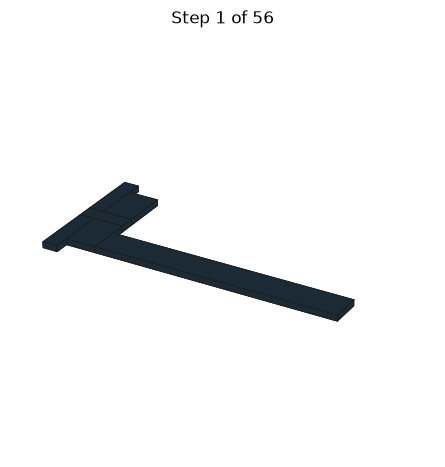

- 1 x 1x3 plate, black
- 2 x 1x4 plate, black
- 1 x 2x16 plate, black
- 2 x 2x3 plate, black

## Step 2

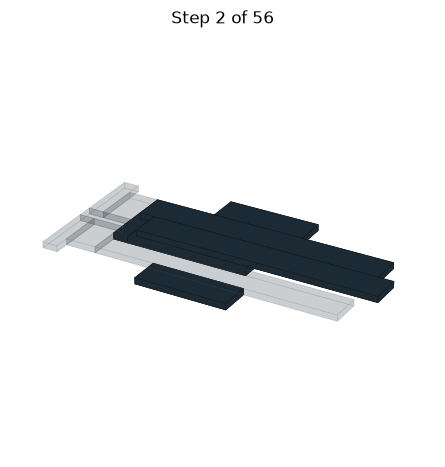

- 1 x 1x3 plate, black
- 1 x 1x8 plate, black
- 2 x 2x16 plate, black
- 2 x 2x6 plate, black

## Step 3

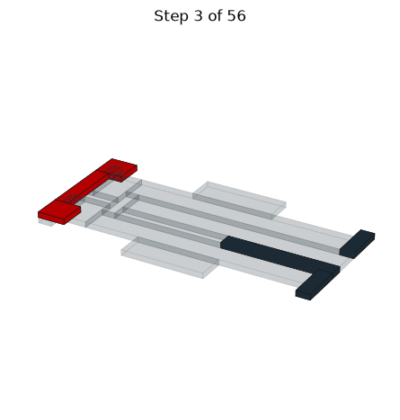

- 2 x 1x3 plate, black
- 1 x 1x5 plate, red
- 1 x 1x8 plate, black
- 2 x 2x2 plate, red

## Step 4

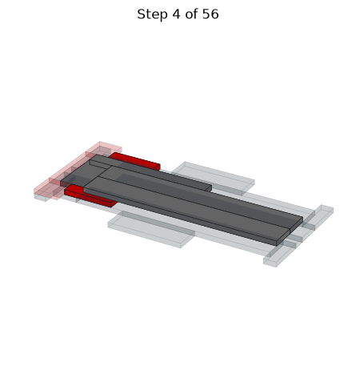

- 1 x 1x10 plate, dark gray
- 2 x 1x4 plate, red
- 2 x 2x16 plate, dark gray
- 1 x 2x4 plate, dark gray

## Step 5

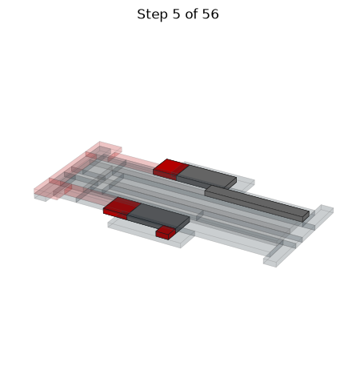

- 1 x 1x1 plate, red
- 1 x 1x8 plate, dark gray
- 2 x 2x2 plate, red
- 2 x 2x4 plate, dark gray

## Step 6

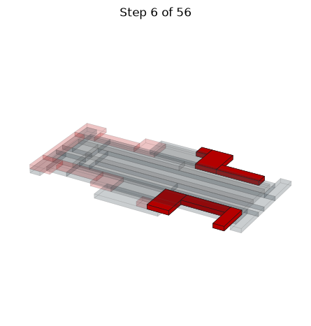

- 1 x 1x1 plate, red
- 1 x 1x3 plate, red
- 2 x 1x4 plate, red
- 2 x 2x3 plate, red

## Step 7

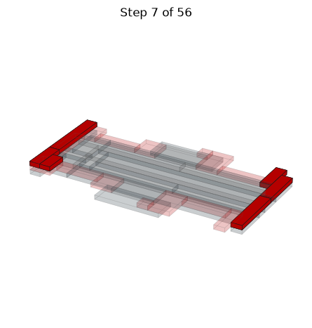

- 1 x 1x2 plate, red
- 2 x 1x3 plate, red
- 1 x 1x4 plate, red
- 1 x 1x5 plate, red
- 1 x 1x6 plate, red

## Step 8

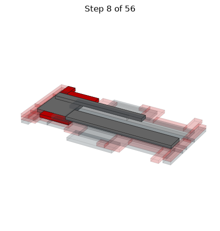

- 1 x 1x12 plate, dark gray
- 1 x 1x2 plate, red
- 2 x 1x4 plate, red
- 1 x 2x14 plate, dark gray
- 1 x 4x4 plate, dark gray

## Step 9

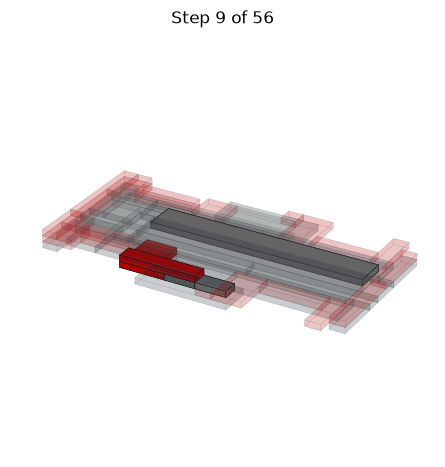

- 1 x 1x3 plate, red
- 1 x 1x5 plate, red
- 1 x 2x14 plate, dark gray
- 1 x 2x2 plate, red
- 1 x swivel hinge plate base (2429), dark gray
- 1 x swivel hinge plate top (2430), dark gray

## Step 10

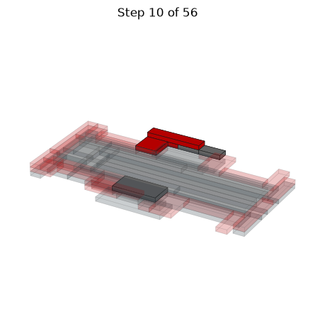

- 1 x 1x3 plate, red
- 1 x 1x5 plate, red
- 1 x 2x2 plate, red
- 1 x 2x4 plate, dark gray
- 1 x swivel hinge plate base (2429), dark gray
- 1 x swivel hinge plate top (2430), dark gray

## Step 11

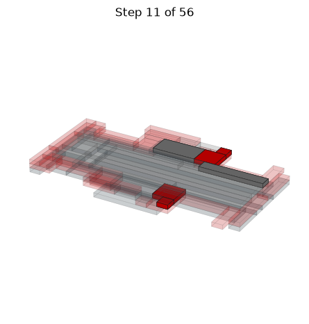

- 2 x 1x1 plate, red
- 1 x 1x6 plate, dark gray
- 2 x 2x2 plate, red
- 1 x 2x4 plate, dark gray

## Step 12

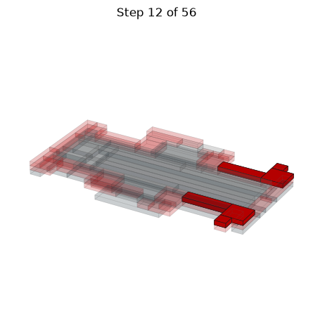

- 2 x 1x1 plate, red
- 2 x 1x4 plate, red
- 2 x 2x2 plate, red

## Step 13

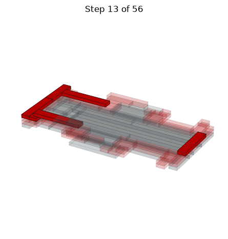

- 1 x 1x1 plate, red
- 1 x 1x4 plate, red
- 2 x 1x5 plate, red
- 2 x 1x6 plate, red

## Step 14

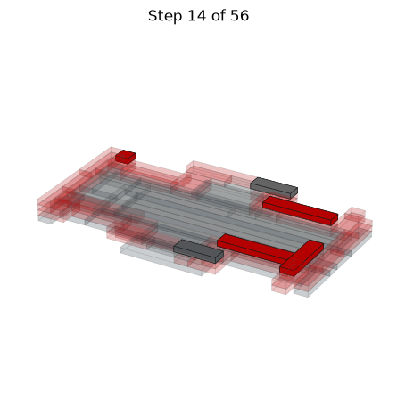

- 1 x 1x1 plate, red
- 2 x 1x3 plate, dark gray
- 1 x 1x4 plate, red
- 2 x 1x5 plate, red

## Step 15

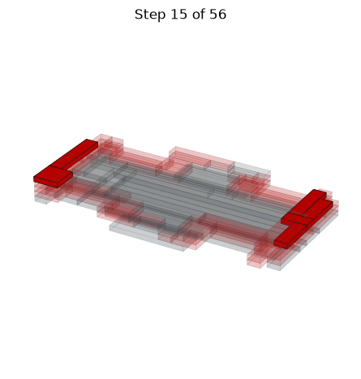

- 1 x 1x2 plate, red
- 2 x 1x3 plate, red
- 1 x 1x4 plate, red
- 1 x 1x5 plate, red
- 1 x 2x2 plate, red

## Step 16

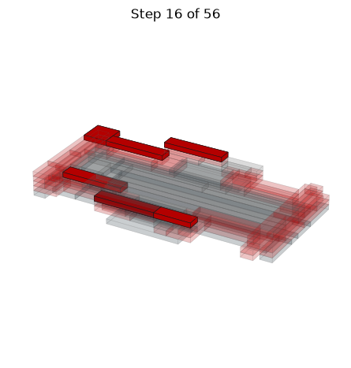

- 1 x 1x3 plate, red
- 4 x 1x5 plate, red
- 1 x 2x2 plate, red

## Step 17

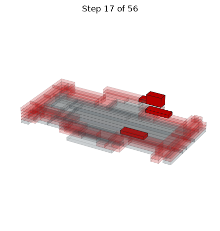

- 1 x 1x1 plate, red
- 1 x 1x2 brick, red
- 2 x 1x3 plate, red

## Step 18

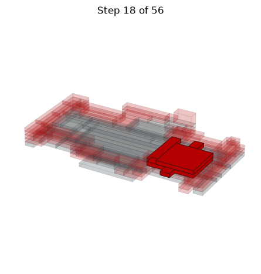

- 1 x 1x2 plate, red
- 1 x 1x3 plate, red
- 1 x 1x4 plate, red
- 1 x 1x5 plate, red
- 1 x 2x4 plate, red
- 1 x 4x4 plate, red

## Step 19

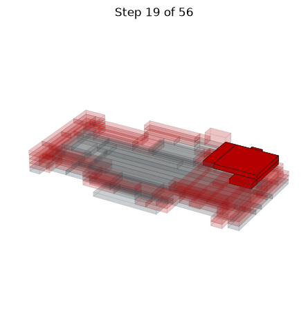

- 2 x 1x2 plate, red
- 2 x 1x4 plate, red
- 1 x 2x4 plate, red
- 1 x 4x4 plate, red

## Step 20

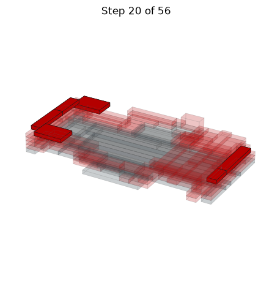

- 1 x 1x2 plate, red
- 1 x 1x3 plate, red
- 1 x 1x4 plate, red
- 1 x 1x5 plate, red
- 2 x 2x3 plate, red

## Step 21

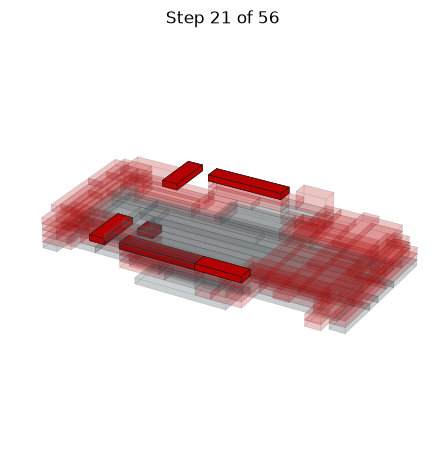

- 1 x 1x1 plate, red
- 3 x 1x3 plate, red
- 2 x 1x5 plate, red

## Step 22

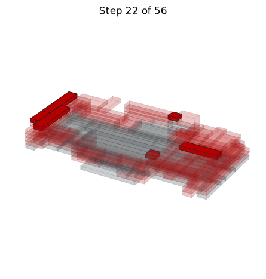

- 2 x 1x1 plate, red
- 1 x 1x2 plate, red
- 1 x 1x4 plate, red
- 2 x 1x5 plate, red

## Step 23

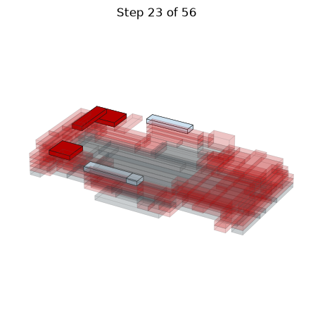

- 1 x 1x1 plate, trans clear
- 1 x 1x4 plate, red
- 2 x 1x4 plate, trans clear
- 2 x 2x2 plate, red

## Step 24

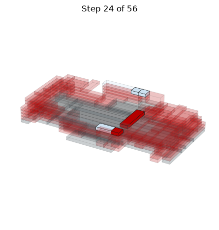

- 1 x 1x1 plate, red
- 2 x 1x1 plate, trans clear
- 1 x 1x2 plate, trans clear
- 1 x 1x4 plate, red

## Step 25

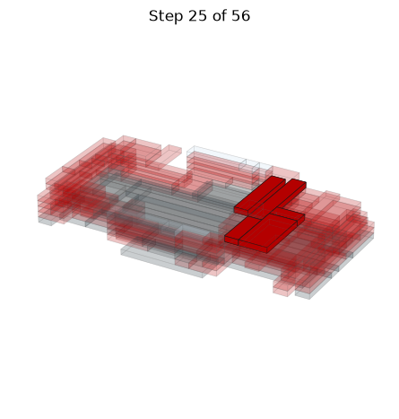

- 1 x 1x2 plate, red
- 2 x 1x3 plate, red
- 1 x 1x5 plate, red
- 1 x 1x6 plate, red
- 1 x 2x4 plate, red

## Step 26

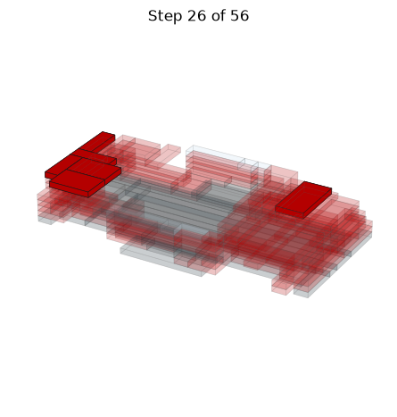

- 3 x 1x3 plate, red
- 2 x 2x3 plate, red
- 1 x 2x4 plate, red

## Step 27

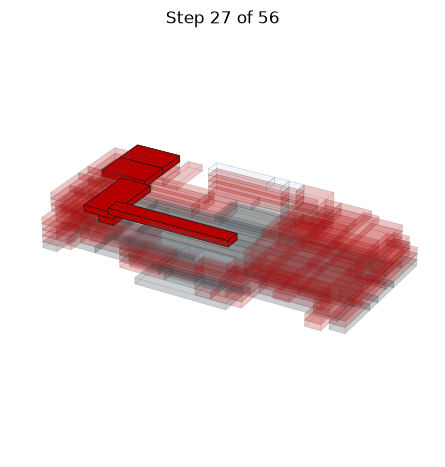

- 1 x 1x1 plate, red
- 1 x 1x8 plate, red
- 2 x 2x3 plate, red
- 1 x 2x4 plate, red

## Step 28

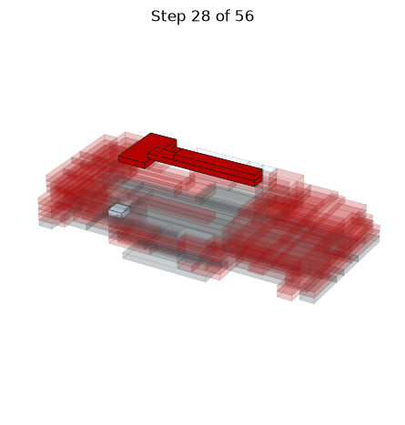

- 2 x 1x1 plate, red
- 1 x 1x1 plate, trans clear
- 1 x 1x6 plate, red
- 1 x 1x8 plate, red
- 1 x 2x4 plate, red

## Step 29

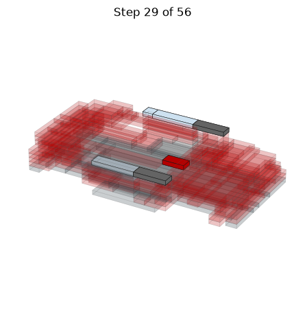

- 1 x 1x1 plate, trans clear
- 1 x 1x2 plate, red
- 2 x 1x3 plate, dark gray
- 2 x 1x4 plate, trans clear

## Step 30

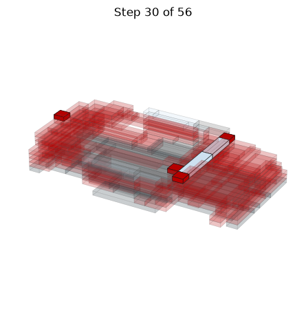

- 4 x 1x1 plate, red
- 1 x 1x3 plate, trans clear
- 1 x 1x4 plate, trans clear

## Step 31

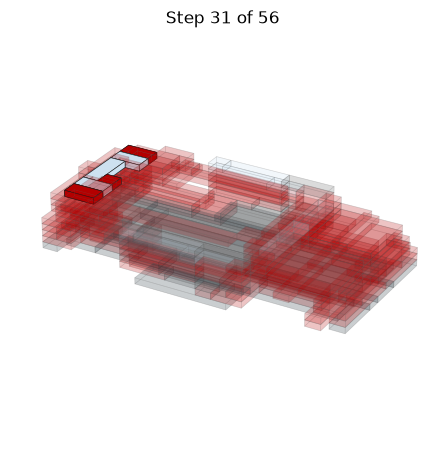

- 1 x 1x1 plate, red
- 2 x 1x2 plate, red
- 2 x 1x2 plate, trans clear
- 1 x 1x3 plate, trans clear

## Step 32

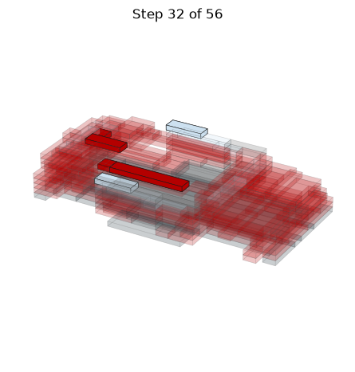

- 2 x 1x1 plate, red
- 1 x 1x3 plate, red
- 2 x 1x3 plate, trans clear
- 1 x 1x6 plate, red

## Step 33

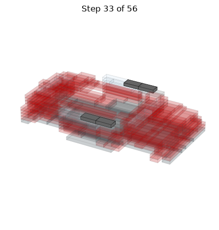

- 2 x swivel hinge plate base (2429), dark gray
- 2 x swivel hinge plate top (2430), dark gray

## Step 34

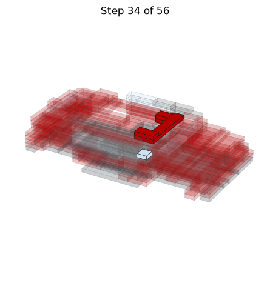

- 2 x 1x1 plate, red
- 1 x 1x1 plate, trans clear
- 2 x 1x2 plate, red
- 1 x 1x6 plate, red

## Step 35

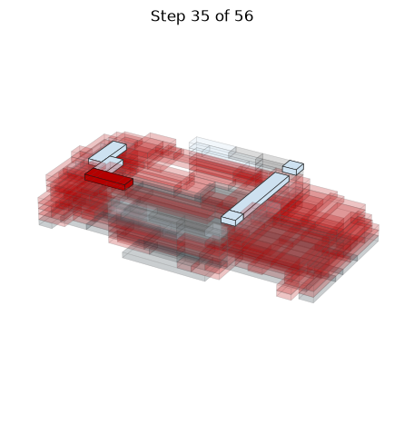

- 2 x 1x1 plate, trans clear
- 1 x 1x2 plate, trans clear
- 1 x 1x3 plate, red
- 1 x 1x3 plate, trans clear
- 1 x 1x6 plate, trans clear

## Step 36

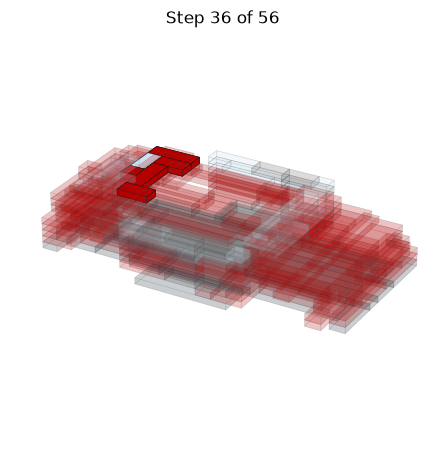

- 1 x 1x1 plate, red
- 2 x 1x2 plate, red
- 1 x 1x2 plate, trans clear
- 2 x 1x3 plate, red

## Step 37

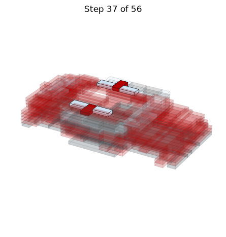

- 2 x 1x2 plate, red
- 4 x 1x2 plate, trans clear

## Step 38

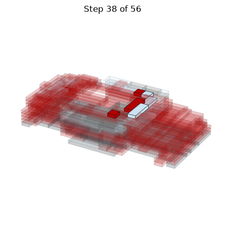

- 2 x 1x1 plate, red
- 1 x 1x1 plate, trans clear
- 1 x 1x2 plate, trans clear
- 1 x 1x3 plate, red
- 1 x 1x3 plate, trans clear

## Step 39

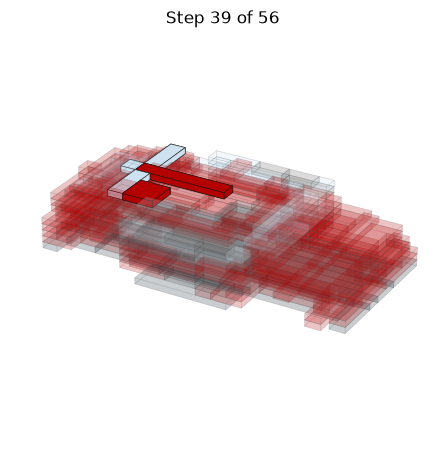

- 1 x 1x1 plate, trans clear
- 2 x 1x3 plate, trans clear
- 1 x 1x6 plate, red
- 1 x 2x2 plate, red

## Step 40

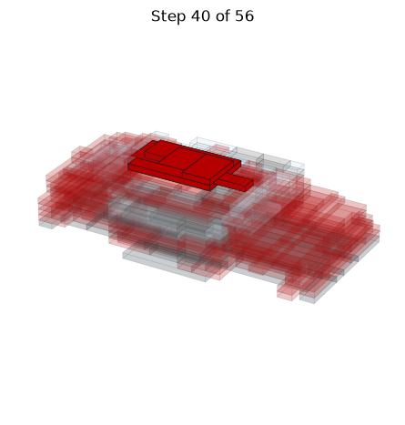

- 1 x 1x3 plate, red
- 1 x 1x6 plate, red
- 3 x 2x3 plate, red
- 1 x 2x6 plate, red

## Step 41

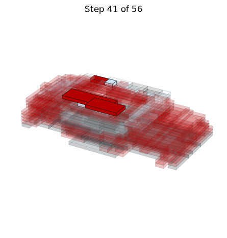

- 1 x 1x1 plate, red
- 2 x 1x1 plate, trans clear
- 1 x 1x2 plate, red
- 1 x 2x4 plate, red
- 1 x 2x6 plate, red

## Step 42

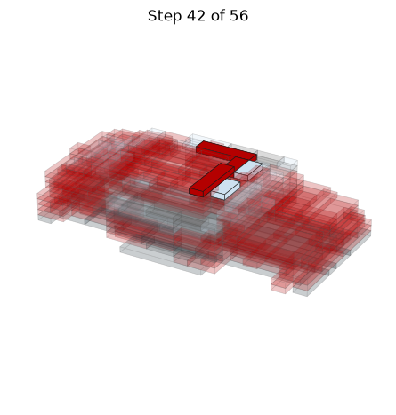

- 1 x 1x1 plate, red
- 1 x 1x2 plate, red
- 2 x 1x2 plate, trans clear
- 2 x 1x4 plate, red

## Step 43

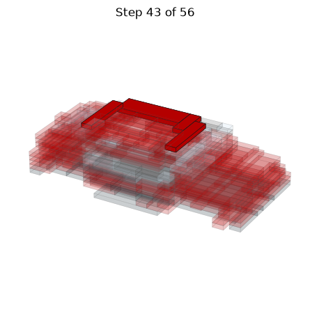

- 1 x 1x3 plate, red
- 2 x 1x5 plate, red
- 1 x 2x6 plate, red

## Step 44 (model upside down)

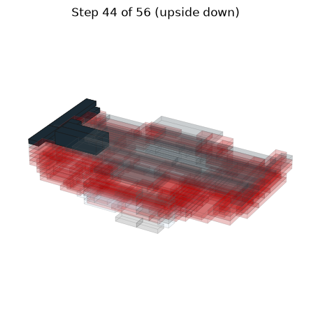

- 2 x 1x3 plate, black
- 2 x 1x4 Technic brick (round holes), black
- 1 x 1x4 plate, black
- 1 x 1x6 plate, black

## Step 45 (model upside down)

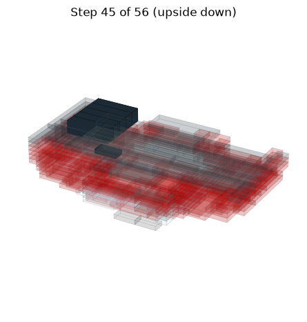

- 1 x 1x2 plate, black
- 5 x 1x4 Technic brick (round holes), black

## Step 46 (model upside down)

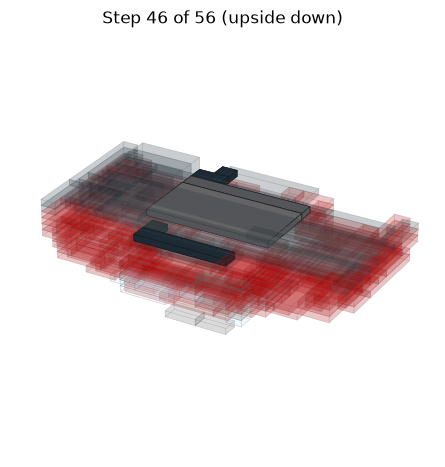

- 2 x 1x1 plate, black
- 1 x 1x2 plate, black
- 1 x 1x6 plate, black
- 1 x 1x8 plate, dark gray
- 1 x 4x8 plate, dark gray

## Step 47 (model upside down)

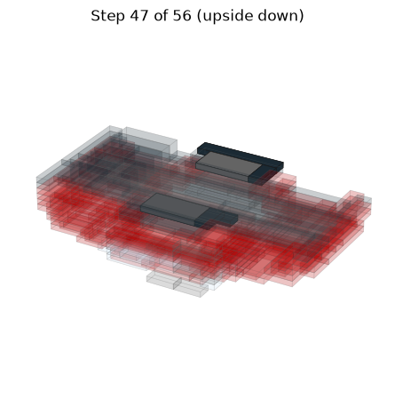

- 1 x 1x1 plate, black
- 2 x 1x2 plate, black
- 1 x 1x6 plate, black
- 2 x 2x4 plate, dark gray

## Step 48 (model upside down)

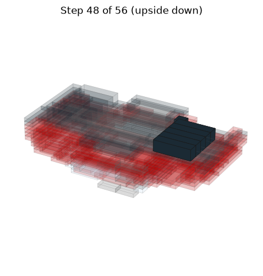

- 1 x 1x1 plate, black
- 5 x 1x4 Technic brick (round holes), black

## Step 49 (model upside down)

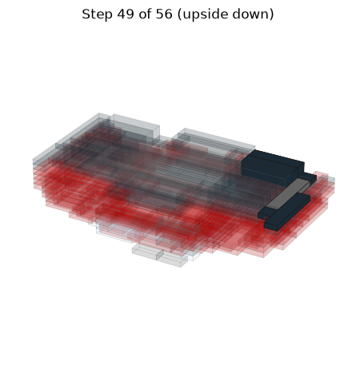

- 2 x 1x1 plate, black
- 2 x 1x4 Technic brick (round holes), black
- 1 x 1x5 plate, black
- 1 x 1x5 plate, dark gray

## Step 50 (model upside down)

- 1 x 1x2 plate, black
- 3 x 1x4 plate, black
- 2 x 1x5 plate, black

## Step 51 (model upside down)

- 1 x 1x3 plate, black
- 3 x 2x3 plate, black
- 2 x 4x6 plate, black

## Step 52 (model upside down)

- 3 x 1x3 plate, black
- 2 x 1x4 plate, black
- 1 x 1x6 plate, black

## Step 53 (model upside down)

- 1 x 1x3 plate, black
- 1 x 1x4 plate, black
- 1 x 1x8 plate, black
- 1 x 2x6 plate, black
- 1 x 2x8 plate, black
- 1 x 4x8 plate, black

## Step 54 (model upside down)

- 1 x 1x2 plate, black
- 1 x 1x4 plate, black
- 2 x 1x5 plate, black
- 1 x 2x6 plate, black

## Step 55

- 1 x Technic axle 11
- 2 x wheel 30.4 x 14 with tire

## Step 56

- 1 x Technic axle 11
- 2 x wheel 30.4 x 14 with tire
